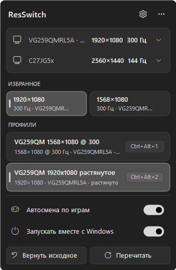
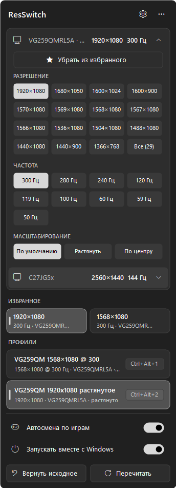
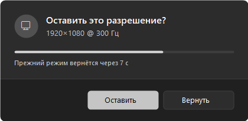

# ResSwitch

Быстрое переключение разрешения экрана в Windows: из трея, горячими клавишами и автоматически при запуске игры. Удобно для растянутых разрешений в CS2, Valorant и других играх.

Один `.exe` без установки. Нужен только .NET Framework 4.x, а он уже есть в Windows 10 и 11.

<p>
  
  
</p>

## Возможности

- **Панель по левому клику на значке**: мониторы, избранные режимы, профили, переключатели.
- **Выбор режима прямо в панели**: разрешение, частота и масштабирование (растянуть / по центру / по умолчанию) для каждого монитора.
- **Избранное**: сохраняйте нужные режимы одной кнопкой.
- **Профили с горячими клавишами**, например `Ctrl+Alt+1` для 1280×960 растянутого.
- **Автосмена по играм**: при запуске `valorant.exe` включится нужный профиль, после выхода из игры вернётся прежнее разрешение.
- **Подтверждение после смены**: если не нажать «Оставить», через 10 секунд вернётся прежний режим. Удобно, если монитор показывает чёрный экран.
- **Мониторы определяются по постоянному ID** (модель из EDID + выход видеокарты), а не по номеру DISPLAYn, который может меняться после перезагрузки.
- Светлая и тёмная тема, цвет акцента Windows, работа с высоким DPI.



## Установка

1. Скачайте `ResSwitch.exe` со страницы [Releases](../../releases/latest).
2. Положите его в любую папку, где можно записывать файлы, например `Документы\ResSwitch`. Не кладите в `Program Files`: рядом с exe создаётся файл настроек.
3. Запустите. Значок появится в трее, при необходимости закрепите его в области уведомлений.

Windows может показать «Windows защитила ваш компьютер», потому что файл не подписан. Нажмите «Подробнее» → «Выполнить в любом случае». Исходный код открыт, программу можно собрать самому (см. ниже).

Автозапуск включается переключателем «Запускать вместе с Windows» в панели.

## Настройки

При первом запуске рядом с exe появляется `ResSwitch.ini` с профилями под ваши мониторы. Открыть его можно кнопкой ⚙ в панели. После правки нажмите «Перечитать».

```ini
[Settings]
ConfirmSeconds=10      ; сколько секунд ждать подтверждения (0 — не спрашивать)
GameWatch=true         ; автосмена по играм

[Profile]
Name=Valorant 1280×960 растянутое
Display=AUS258D#UID4353  ; ID монитора: меню по правому клику → монитор → «Скопировать ID»
Mode=1280x960@240        ; частоту можно не указывать — возьмётся максимальная
Scaling=stretch          ; keep | default | stretch | center
Hotkey=Ctrl+Alt+1
Game=valorant.exe        ; несколько игр — через запятую

[Favorites]              ; заполняется из панели кнопкой «Добавить в избранное»
Fav=AUS258D#UID4353:1920x1080@240:stretch
```

В `Display` можно указать ID монитора, его название (`VG259QM`), `primary` или номер (`1`, `2`). Номер может меняться после перезагрузки, ID — нет.

Ваш `ResSwitch.ini` привязан к вашим мониторам. Другу отправляйте только exe: у него настройки создадутся сами.

## Командная строка

```bat
ResSwitch.exe --list                                   :: мониторы, их ID и доступные режимы
ResSwitch.exe --set 1920x1080@144 --display primary    :: сменить режим
ResSwitch.exe --set 1280x960 --display AUS258D#UID4353 --scaling stretch --test   :: только проверить
```

## Сборка

```bat
build.bat
```

Нужен только компилятор `csc.exe` из .NET Framework 4.x, он есть в каждой Windows. Весь код в одном файле, `ResSwitch.cs`.

## Лицензия

[MIT](LICENSE)

---

**English:** ResSwitch is a tiny Windows tray app for switching screen resolution, refresh rate and scaling (stretched / centered), with hotkeys, favorites, per-game auto-switching and stable monitor IDs. Download `ResSwitch.exe` from [Releases](../../releases/latest) and run it. The interface is in Russian.
